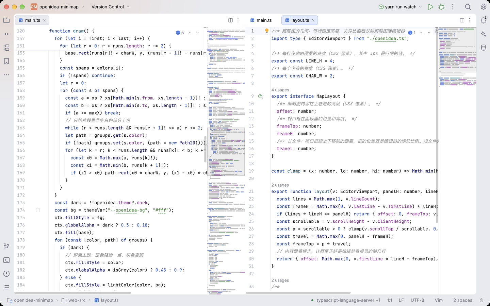
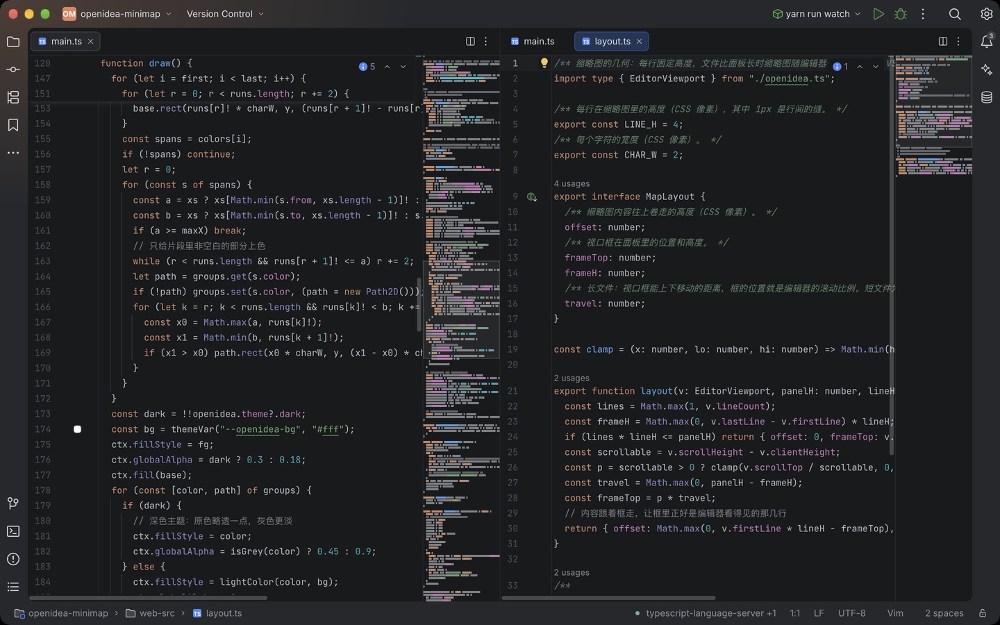
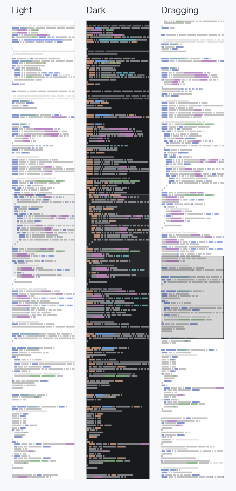

# OpenIDEA Minimap

English · [简体中文](https://github.com/wildcatDownstairs/openidea-minimap/blob/main/README.zh-CN.md)

A code minimap for [OpenIDEA](https://github.com/l0ng-ai/openidea): the whole file in its syntax colours at the
right edge of every editor (4px per line, 2px per character), the visible area as a frame you can drag.

- Click the minimap: the editor jumps to the line you clicked, centred
- Drag the frame: the editor scrolls with it; the wheel goes to the editor
- The frame shows only while the pointer is over the minimap (like VS Code's default)
- With OpenIDEA 0.1.48 or later: errors and warnings as bars at the right edge, VCS
  changes at the left edge in the gutter's colours, the selected lines and the caret's line tinted, folded code left
  out, wrapped lines drawn on as many rows as the editor shows, tabs as wide as in the editor, and semantic highlighting
  colours. Older IDEs keep the rest.
- Section headers: `// MARK: Title`, `// MARK: - Title` (with a separator line) and named `#region Title` comments are
  written out as small labels
- When the file is longer than the panel, the minimap scrolls along with the editor (like VS Code / CodeGlance)
- Follows the theme: dark themes use the syntax colours as they are; light themes follow WebStorm's minimap, with
  the syntax colours mixed half-way into the background
- In a split editor each side has its own panel; switching tabs doesn't reload the page

It is a web page only (no WASM code) on the `[[contributes.editorPanels]]` extension point of plugin API 1.9
([l0ng-ai/openidea#3677](https://github.com/l0ng-ai/openidea/pull/3677)), so it needs an OpenIDEA with plugin
API 1.9 (0.1.46 or later). It asks for one capability, `editor.read` (low risk): the page reads the text and
syntax colours of the files the editors show, to draw them. It has no network or process access.







## Install

Search for Minimap in Settings › Plugins › Available; or download the `.oiplugin` from
[Releases](https://github.com/wildcatDownstairs/openidea-minimap/releases) and install it with
_Install Plugin from Package File…_.

## Layout

```
plugin.toml        manifest
icons/             plugin icon (light and dark)
web-src/           page source (TypeScript + Vite)
  main.ts          drawing and interaction
  layout.ts        minimap geometry (frame position, drag conversion)
  layout.test.ts   tests for layout
  sections.ts      section headers (MARK / region)
  openidea.ts      types used from window.openidea
web/               build output, what the package ships (not committed; run yarn build before packing)
docs/              README screenshots (not in the package)
```

## Build

Needs Node 24 (the tests run TypeScript directly) and Yarn 4.

```bash
yarn install
```

```bash
yarn build    # type check + output to web/
```

```bash
yarn test     # tests
```

```bash
yarn watch    # rebuild on change, use with Reload in the IDE
```

`web/` is build output and not committed: run `yarn build` before packing (`openidea-plugin pack`).

## Debugging in the IDE

1. `yarn build`
2. Check and link it with an `openidea-plugin` that supports API 1.9 (shipped with OpenIDEA releases, or
   `cargo run -p ide-host --bin openidea-plugin --` in the OpenIDEA repository):

   ```bash
   openidea-plugin check .
   ```

   ```bash
   openidea-plugin link .
   ```

   `link` writes to the plugin directory of the released IDE by default; to link to the development build
   started by `pnpm dev:app` only, set `OPENIDEA_PLUGINS_DIR=<dev data directory>/plugins`.
3. Allow `editor.read` in Settings › Plugins and open any text file.
4. After changing the code, `yarn build`, then _Reload_ in Settings › Plugins. Panels that are already open don't
   reload their page: remount the panel (for example reopen the project window) to see the new page.

## Release

```bash
yarn build
```

```bash
openidea-plugin pack . --key <publisher private key> --publisher wildcatdownstairs
```

Attach the resulting `wildcatdownstairs.minimap-<version>.oiplugin` to a GitHub Release, then open a PR to
[openidea-plugins](https://github.com/l0ng-ai/openidea-plugins) that updates `[[versions]]`.

## Implementation notes

- Only the few hundred lines visible in the panel are drawn; a redraw takes about 0.15ms (measured while
  scrolling a 10,000-line file, 1ms at most).
- No `requestAnimationFrame` for redraws: WebKit throttles rAF in sandboxed iframes, and it kept up with only
  about 40% of scroll frames. The host sends `onViewport` at most once per frame, and the page draws when it
  arrives (several requests in one task are merged with a microtask).
- Highlights are loaded lazily in blocks of 1000 lines, only the blocks near the visible area; `onHighlights`
  only marks blocks stale, the old colours stay until the new ones arrive.
- For long files the frame is placed by the editor's scroll ratio; while dragging, the target line is estimated
  from the current viewport by the average line height and corrected on each viewport update, so the frame stays
  under the pointer even when code lenses and folding make line heights uneven.
- Tabs are as wide as in the editor (`get().tabSize`, API 1.10), 4 columns in older IDEs; full-width characters count as 1.

## Contact

Questions, bugs and suggestions: [GitHub Issues](https://github.com/wildcatDownstairs/openidea-minimap/issues).

## License

[MIT](LICENSE)
