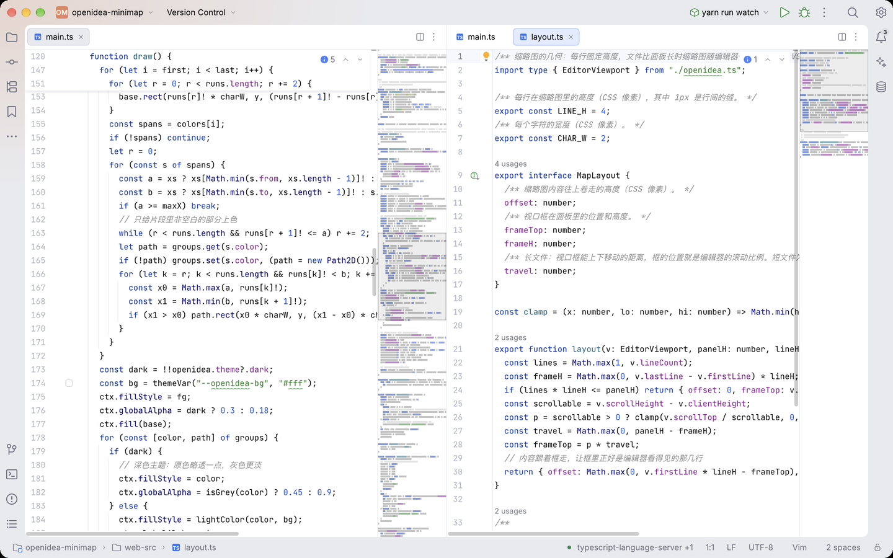
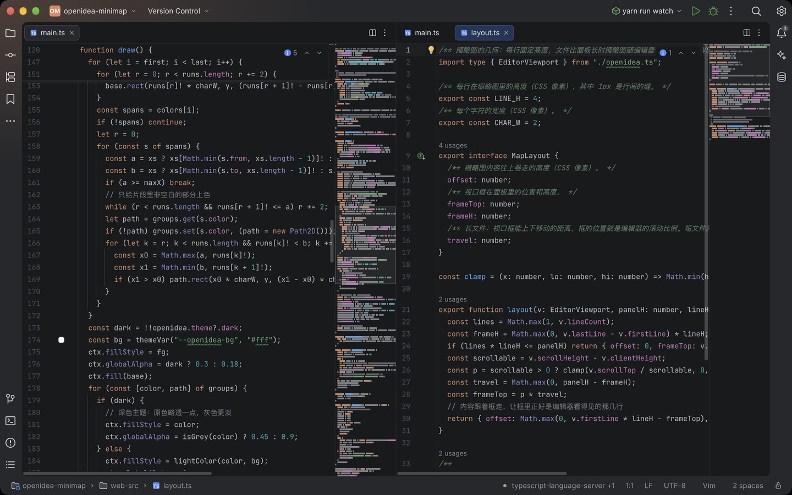
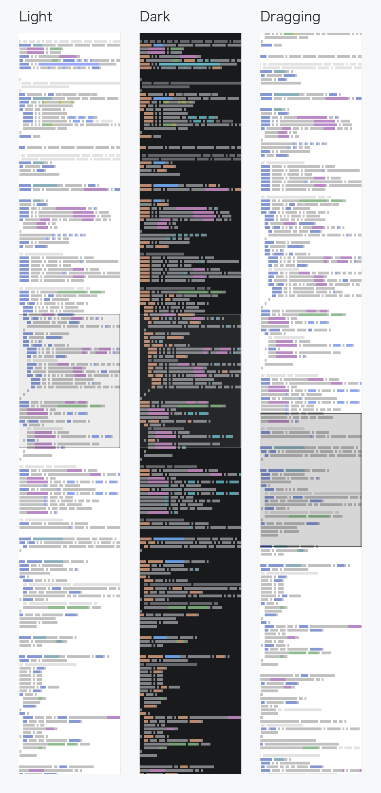

# OpenIDEA Minimap

[English](https://github.com/wildcatDownstairs/openidea-minimap/blob/main/README.md) · 简体中文

[OpenIDEA](https://github.com/l0ng-ai/openidea) 的代码缩略图插件：编辑器右侧按语法高亮画出整个文件
（每行 4px、每个字符 2px 的色块），当前可见区画成一个框。

- 点击缩略图：编辑器跳到点中的那一行，并把它放在中间
- 拖动框：编辑器跟着滚动；滚轮交给编辑器
- 文件比面板长时缩略图跟着编辑器一起滚动（和 VS Code / CodeGlance 一样）
- 跟随主题：深色主题直接用语法色；浅色主题照 WebStorm 的缩略图，语法色和背景混成一半深浅的浅色
- 分屏时每一侧各一个面板，切换标签页不重新加载页面

只有页面、没有 WASM 代码，用的是插件 API 1.9 的 `[[contributes.editorPanels]]` 扩展点
（[l0ng-ai/openidea#3677](https://github.com/l0ng-ai/openidea/pull/3677)），需要带 API 1.9 的 OpenIDEA（0.1.46 及以后）。
需要 `editor.read` 权限（低风险）：页面要读编辑器显示的文件的文本和语法颜色才能画出来；没有网络和进程权限。







## 安装

Settings › Plugins › Available 里搜索 Minimap 安装；或从
[Releases](https://github.com/wildcatDownstairs/openidea-minimap/releases) 下载 `.oiplugin`，
用 _Install Plugin from Package File…_ 安装。

## 目录

```
plugin.toml        清单
icons/             插件图标（亮色、暗色）
web-src/           页面源码（TypeScript + Vite）
  main.ts          绘制和交互
  layout.ts        缩略图几何（视口框位置、拖动换算）
  layout.test.ts   layout 的测试
  openidea.ts      window.openidea 里用到的类型
web/               构建产物，插件包实际带的就是它（不提交，打包前 yarn build）
docs/              README 里的截图（不进插件包）
```

## 构建

需要 Node 24（测试直接跑 TS）和 Yarn 4。

```bash
yarn install
```

```bash
yarn build    # 类型检查 + 输出到 web/
```

```bash
yarn test     # layout 的测试
```

```bash
yarn watch    # 改了就重新构建，配合 IDE 里的 Reload 使用
```

`web/` 是构建产物，不提交到仓库：打包（`openidea-plugin pack`）前先 `yarn build`。

## 在 IDE 里调试

1. `yarn build`
2. 用支持 API 1.9 的 `openidea-plugin` 检查并链接（随 OpenIDEA 发布，或在 OpenIDEA 仓库里
   `cargo run -p ide-host --bin openidea-plugin --`）：

   ```bash
   openidea-plugin check .
   ```

   ```bash
   openidea-plugin link .
   ```

   `link` 默认写进正式版 IDE 的插件目录；只想链接到 `pnpm dev:app` 启动的开发版时，
   设 `OPENIDEA_PLUGINS_DIR=<开发版的数据目录>/plugins`。
3. Settings › Plugins 里允许 `editor.read`，打开任意文本文件即可看到。
4. 改代码后 `yarn build`，再在 Settings › Plugins 里 _Reload_。注意：已经打开的面板不会重新加载页面，
   要让面板重新挂载（例如重新打开项目窗口）才能看到新页面。

## 发布

```bash
yarn build
```

```bash
openidea-plugin pack . --key <发布者私钥> --publisher wildcatdownstairs
```

把生成的 `wildcatdownstairs.minimap-<版本>.oiplugin` 附到 GitHub Release，
再向 [openidea-plugins](https://github.com/l0ng-ai/openidea-plugins) 提 PR 更新 `[[versions]]`。

## 实现要点

- 只画面板里看得见的那几百行；每次重绘约 0.15ms（1 万行文件、滚动时实测，最长 1ms）。
- 不用 `requestAnimationFrame` 重绘：WebKit 会给沙箱 iframe 的 rAF 限流，实测只跟上约 4 成的滚动帧。
  宿主每帧最多发一次 `onViewport`，收到就画（同一任务里的多次请求用 microtask 合并）。
- 高亮按 1000 行一块懒加载，只取可见区附近的块；`onHighlights` 只把块标成过期，旧颜色先留着，新颜色到了再换。
- 长文件的视口框按编辑器的滚动比例定位；拖动时从当前视口按平均行高推算目标行，每次视口更新再校正，
  代码透镜、折叠造成的行高不一也能让框停在指针下。
- tab 按 4 列算（接口里拿不到编辑器的 tab 宽度）；全角字符按 1 列算。

## 联系方式

问题、Bug 和建议请提到 [GitHub Issues](https://github.com/wildcatDownstairs/openidea-minimap/issues)。

## 许可证

[MIT](LICENSE)
